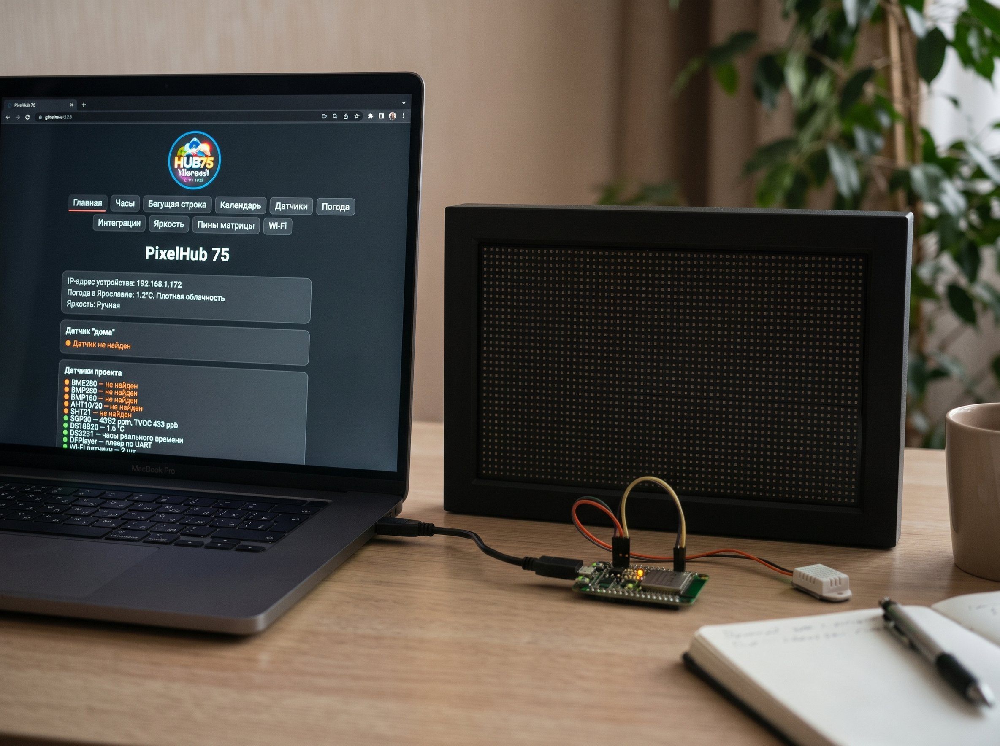
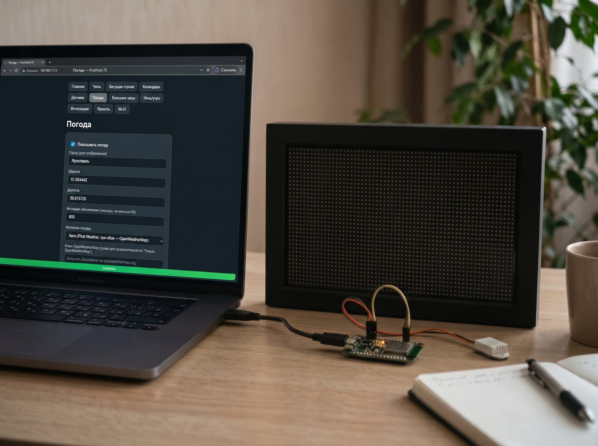
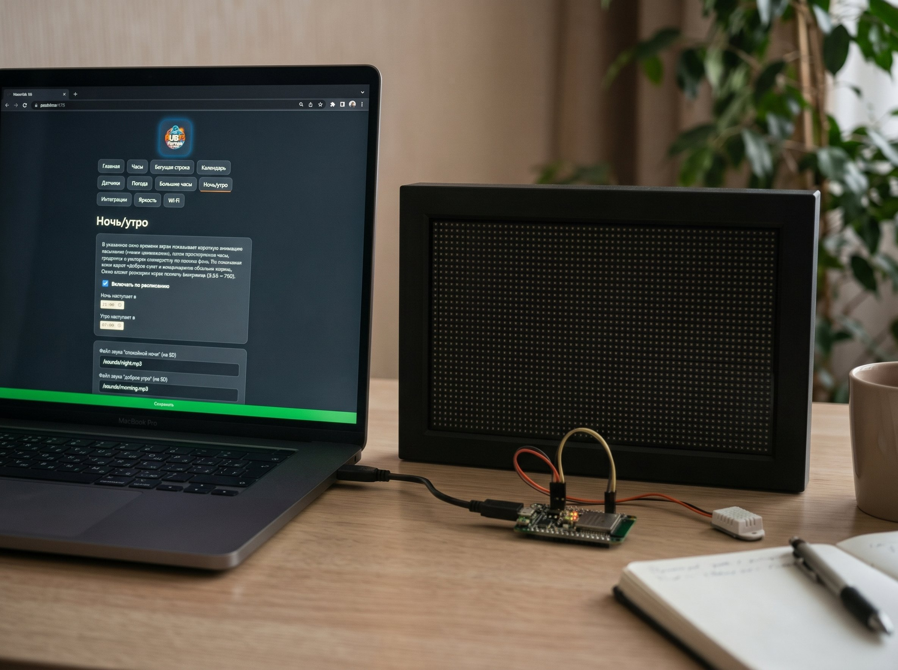
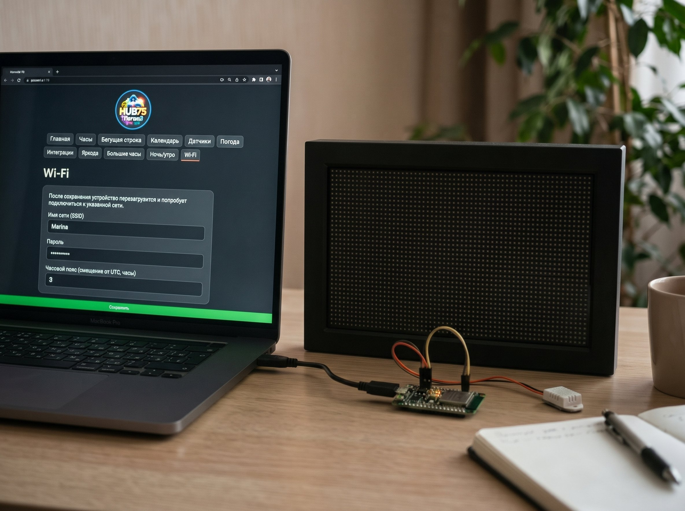
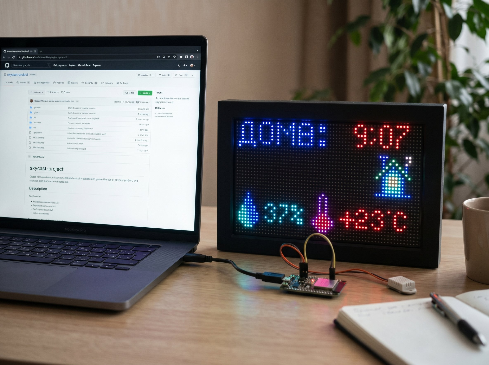
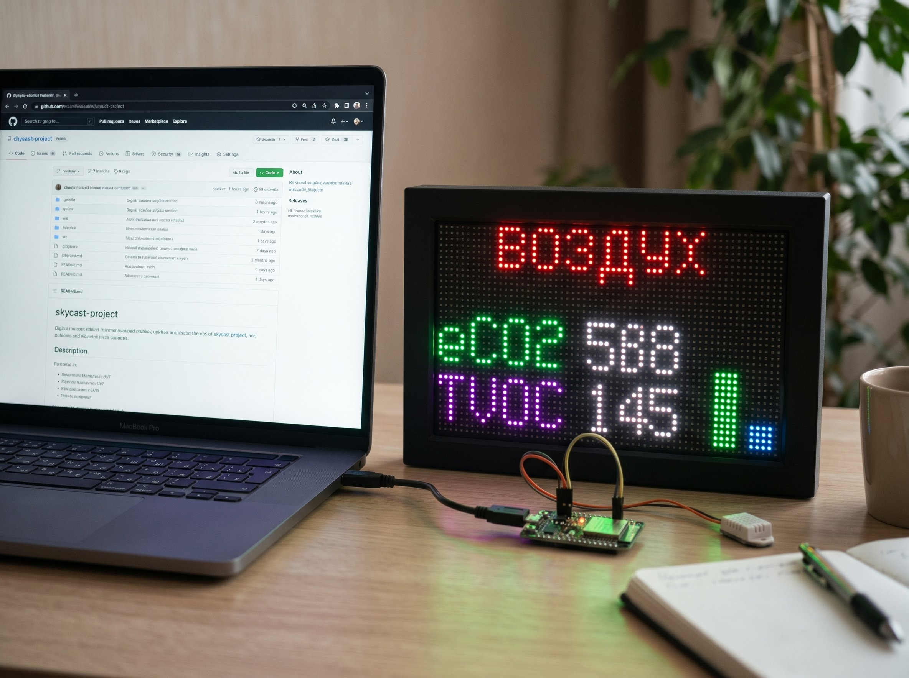
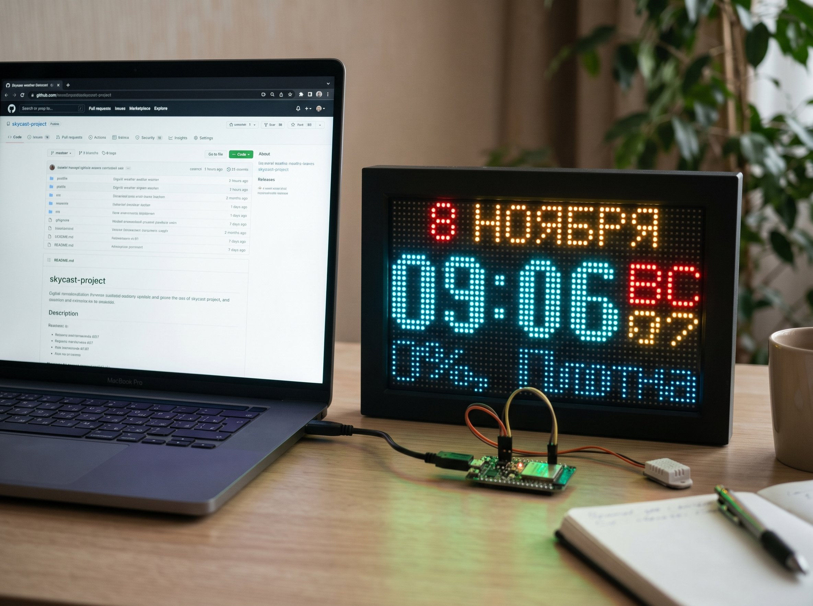
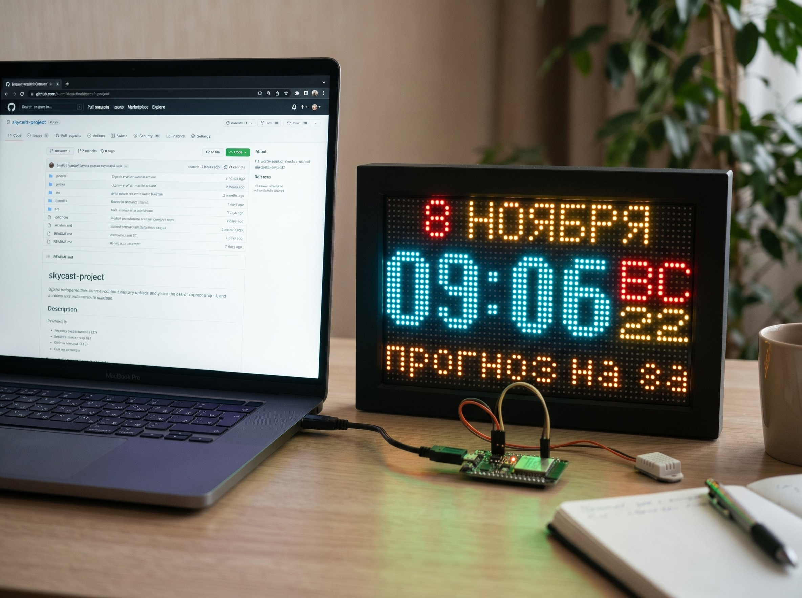
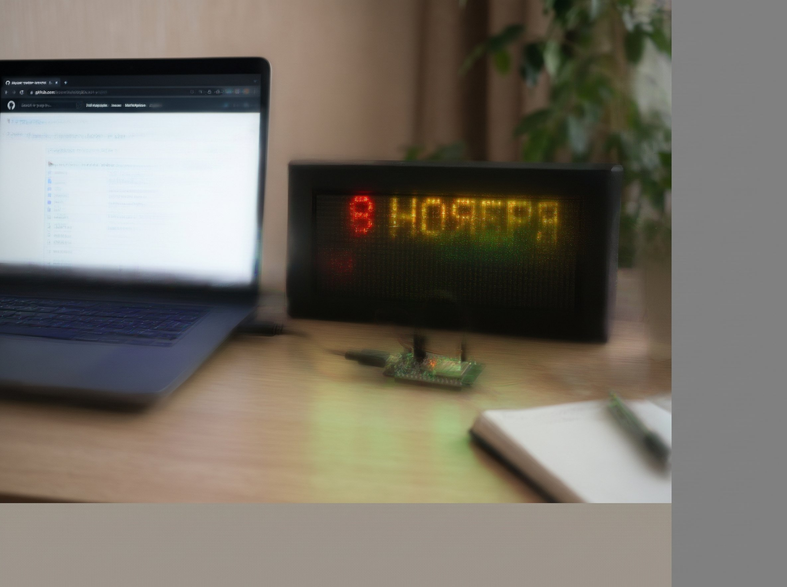

# PixelHub 75 — выездная сборка (ESP32 + HUB75 64×32)

Информер на ESP32 для работы вне дома: часы, погода и прогноз, «Дома», «Комнаты», «Качество воздуха», бегущая строка, календарь, будильники и озвучка через DFPlayer.

Сборка одна — **`esp32dev_remote`**: погода через Pirat Weather и OpenWeatherMap, без домашнего сервера.

## Скриншоты

| Веб-интерфейс | | |
|---|---|---|
|  |  |  |
| Главная: датчики проекта | Часы, звук и будильники | Погода и цвета |
|  |  |  |
| Ночь/утро | Датчики по Wi-Fi | Экран «Воздух» |

| Матрица 64×32 | | |
|---|---|---|
|  |  |  |
| Часы и дата | Прогноз на 3 дня | Дата и время |

## Железо

- ESP32-WROOM-32, 4 МБ флеша (без PSRAM);
- матрица HUB75 64×32, развёртка 1/16;
- I2C: BME280/BMP280/BMP180/AHT10/AHT20/SHT21/SGP30/DS3231;
- уличный DS18B20 (1-Wire);
- DFPlayer Mini по UART2.

### Пины по умолчанию

```
Матрица:  R1=4  G1=2  B1=5  R2=13 G2=14 B2=23
          A=12 B=16 C=17 D=18 E=-1
          LAT=32 OE=33 CLK=15
I2C:      SDA=21 SCL=22
DS18B20:  DATA=3
DFPlayer: TX платы=19, RX платы=35
```

Пины матрицы меняются на `/settings/pins`, DS18B20 и DFPlayer — `/settings/hwpins`.

## Сборка

```bash
pio run -e esp32dev_remote
pio run -e esp32dev_remote -t upload
```

Полный образ для прошивки «с нуля» (адрес `0x0`):

```bash
pio run -e esp32dev_remote
esptool --chip esp32 merge-bin -o pixelhub75-remote-4mb.bin \
  --flash_mode dio --flash_freq 40m --flash_size 4MB \
  0x1000 .pio/build/esp32dev_remote/bootloader.bin \
  0x8000 .pio/build/esp32dev_remote/partitions.bin \
  0xe000 ~/.platformio/packages/framework-arduinoespressif32/tools/partitions/boot_app0.bin \
  0x10000 .pio/build/esp32dev_remote/firmware.bin
```

## Файловая система

```bash
pio run -e esp32dev_remote -t buildfs
```

Перед сборкой скопируйте `data/config.example.json` в `data/config.json` и укажите сеть Wi-Fi.

## Внешний сервер

В сборке используется адрес `YOUR-TUNNEL.example.com` (погода/датчики по HTTPS).
Замените его в `src/weather.cpp` и `src/local_sensors.cpp` на свой сервис либо оставьте только ключи Pirat/OpenWeatherMap.

## Веб-интерфейс

- `/` — состояние, датчики (зелёный/красный), перезагрузка;
- `/settings/clock` — часы, звук, будильники;
- `/settings/weather` — погода, координаты, ключи, цвета;
- `/settings/sensors` — Wi-Fi датчики (`POST /api/sensor?id=..&t=..&h=..&p=..`);
- `/settings/pins`, `/settings/hwpins` — пины;
- `/settings/update` — OTA, пароль по умолчанию `pixelhub`;
- `/api/heap`, `/api/home`, `/api/df` — диагностика.

## Обновление по воздуху

```
http://IP-платы/settings/update  → выбрать firmware.bin, пароль pixelhub
```

или `GET /update/url?url=http://сервер/firmware.bin`.

## Датчики по Wi-Fi

```
http://<IP платы>/api/sensor?id=kitchen&t=22.5&h=45&p=1013
```

Готовая прошивка датчика: https://github.com/Raven85V/wifi-sensor

## Лицензия

Код предоставляется как есть. Сторонние библиотеки — под своими лицензиями.
